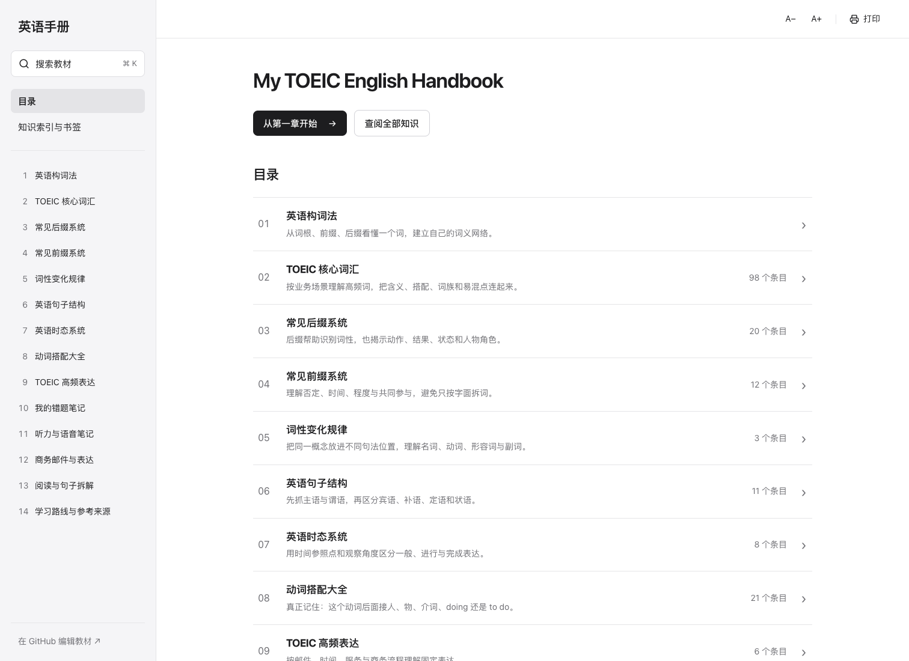

<div align="center">

# My TOEIC English Handbook

**把零散的英语知识，读成一本持续生长的书。**

[在线阅读](https://sver0411.github.io/TOEICHandbook/) · [知识索引](https://sver0411.github.io/TOEICHandbook/library/) · [构词法导读](https://sver0411.github.io/TOEICHandbook/read/word-building/)

</div>

个人英语教材阅读网站，采用 **Next.js App Router、React、TypeScript、Tailwind CSS**。静态生成所有教材页面，通过 GitHub Pages 发布；没有登录、用户账户、在线练习、打卡、积分或游戏化功能。

界面采用苹果式简洁排版与黑白配色，移除封面装饰、宣传卡片与无用小字；以查阅效率为主，不单独做移动端适配。

教材按商务与日常英语场景整理，包含中文解释、原创英文例句、搭配、词性变化和易混点。“TOEIC 场景”表示学习用途，不代表官方真题或经统计的频率排名。示范错因笔记明确标注为示例，方便替换成自己的内容。



## 已收录的内容

| 内容 | 数量 |
| --- | ---: |
| 章节 | 14 |
| 词汇独立页面 | 98 |
| 后缀 | 20 |
| 前缀 | 12 |
| 语法知识 | 23 |
| 动词搭配 | 20 |
| 高频表达专题 | 6（36 组表达） |
| 阅读、邮件、听力与示范错因笔记 | 10 |

前十章对应构词法、核心词汇、后缀、前缀、词性变化、句子结构、时态、动词搭配、高频表达、错因笔记；另增加听力语音、商务邮件、阅读方法和学习路线四章。

## 阅读功能

- 左侧章节导航，中间正文，右侧本页目录、词族与构词关联；桌面端以目录与正文阅读为中心。
- 全文搜索标题、中文解释、例句和正文，支持大小写归一化与词缀符号；`⌘K` / `Ctrl+K` 打开搜索，`Esc` 关闭。索引按需加载。
- 独立单词、语法与词缀地址，支持直接打开和刷新。
- Markdown 标题、加粗、高亮、表格、代码块、引用、图片和折叠区域。
- 本机书签、继续阅读、可调正文字号。
- 浏览器打印 / 保存 PDF。字号、书签和最后阅读页保存在当前浏览器的 localStorage 中，不跨设备同步。
- 内容链接与结构在构建前校验，新增条目自动进入章节、知识索引和搜索。

## 项目结构

```text
TOEICHandbook/
├── app/
│   ├── page.tsx                  # 教材首页
│   ├── layout.tsx                # 通用书架布局
│   ├── globals.css               # 响应式阅读样式与配色
│   ├── read/[slug]/page.tsx       # 所有教材的独立页面
│   └── library/page.tsx          # 分类索引与本机书签
├── components/                   # 搜索、正文、导航、阅读工具等
├── lib/
│   ├── content.ts                # 构建时读取 Markdown
│   ├── search.ts                 # 搜索归一化与相关性排序
│   ├── storage.ts                # 本机阅读设置
│   └── types.ts                  # 内容模型
├── content/
│   ├── book.json                 # 首页文案与阅读入口
│   ├── chapters/                 # 章节导读
│   ├── vocabulary/               # 每个单词一个 Markdown
│   ├── grammar/                  # 语法知识
│   ├── suffix/                   # 后缀
│   ├── prefix/                   # 前缀
│   ├── patterns/                 # 动词结构
│   ├── expressions/              # 固定表达
│   └── reference/                # 听力、阅读、邮件、错因笔记
├── scripts/check-content.ts      # 校验并生成全文索引
├── tests/                        # 内容、搜索及浏览器验证
├── .github/workflows/pages.yml   # CI 与 GitHub Pages 自动发布
└── next.config.ts                # 静态导出与部署路径
```

学习内容均在 `/content` 中，组件负责排版和交互。文件名是全站唯一的英文 slug，例如 `employment.md` 对应 `/read/employment/`。`kind` 必须与目录名一致，`chapter` 必须对应已存在的章节编号。

## 启动方法

需要 Node.js 22 或更新的兼容版本。

```bash
git clone https://github.com/Sver0411/TOEICHandbook.git
cd TOEICHandbook
npm ci
npm run check:content
npm run dev
```

打开 `http://localhost:3000`。第一次本地运行前，`check:content` 会生成全文搜索索引；修改正文后再次运行即可更新开发环境搜索。

```bash
npm run check:content  # 栏目、slug、章节与链接校验
npm test              # 搜索与内容关系测试
npm run typecheck     # TypeScript 检查
npm run build         # 自动校验内容，然后导出到 out/
npm run preview       # 预览静态产物；根据输出的端口打开
npm run test:browser  # 构建后运行桌面浏览器功能测试（本机使用 Chrome）
```

静态网站应通过 HTTP 服务或部署地址打开，不能双击 `out/index.html` 当作单文件网页。线上地址无需本机启动服务。

## 如何添加章节

在 `content/chapters/` 新建 `pronunciation.md`，按下面模板填写：

```markdown
---
title: "英语发音基础"
kind: "chapters"
chapter: 15
order: 15
summary: "理解单词重音、音节与基础发音规律。"
tags: ["PRONUNCIATION"]
related: []
---

## 从音节开始

在这里写正文、示例和解释。

## 阅读路线

添加与你的学习目标有关的条目。
```

新章节自动进入首页和侧栏。将知识条目的 `chapter` 设为 `15`，它们就会自动出现在该章下方。无需修改页面组件。发布前运行校验与构建。

## 如何添加单词页面

在 `content/vocabulary/` 新建 `collaborate.md`：

```markdown
---
title: "collaborate"
kind: "vocabulary"
chapter: 2
summary: "合作；共同完成任务。"
phonetic: "/kəˈlæbəreɪt/"
pos: "verb"
tags: ["团队合作"]
family: ["collaboration", "collaborative"]
related: ["participate", "inter"]
---

## 核心含义

合作完成任务，强调多方共同参与。

## 常用搭配与结构

- collaborate with somebody
- collaborate on a project

## 例句与解析

> The two teams will collaborate on the project.
>
> 两个团队将共同开展这个项目。

with 引出合作方，on 引出共同开展的事项。

## 词性变化与词族

collaboration（名词）；collaborative（形容词）。

## 易混与常见错误

collaborate 是不及物动词，不直接接 project 作为宾语。

## TOEIC 场景

跨部门项目、合作协议与团队安排。
```

`related` 填写已存在的文件 slug，构建会检查它们是否有效。`family` 可记录尚未建立独立页面的真实词形：已有页面自动生成链接，其余以普通文字显示。新增词族页面后，会自动成为可点击链接。构词关系应明确写入 `related`，避免只凭词尾自动猜词缀。

## 添加其他教材与格式

复制对应目录中的 Markdown，修改标题、slug、章节与关系。每个语法页必须包含 **结构、使用场景、时间关键词、常见错误、TOEIC 例句** 五项。后缀页建议保持含义、规则、常见词、例句与应用栏目。

```markdown
## 二级标题

**重点** 与 ==高亮内容==。

> The report has been approved.
>
> 报告已获批准。

[关联词](/read/approve/)

<details>
<summary>展开补充解释</summary>

这里支持 Markdown 正文。

</details>
```

图片放在 `public/images/`，正文使用 ``，部署子路径会自动补齐。内部链接统一写 `/read/文件名/`。Markdown 的原始 HTML 会被清理，不执行任意脚本或事件处理器。

## 发布到 GitHub Pages

仓库 Settings → Pages → Source 选择 **GitHub Actions**。推送到 `main` 后，工作流安装锁定依赖、校验内容、运行测试和类型检查，再以 `NEXT_PUBLIC_BASE_PATH=/TOEICHandbook` 构建并发布。深层地址可直接访问，不依赖服务器动态路由。

若改仓库名或部署到另一个域名，修改工作流里的 `NEXT_PUBLIC_BASE_PATH`；部署在域名根路径时清空该变量。`npm run build` 的输出目录为 `out/`，也可以部署到其他静态托管服务。

## 内容边界与参考

英文例句和中文说明为原创学习材料；需要精确查询词义、发音与用法时可使用 [Cambridge Dictionary](https://dictionary.cambridge.org/)。考试类型以 [ETS TOEIC 官方介绍](https://www.ets.org/toeic/about.html) 为准。语法可参考 [British Council](https://learnenglish.britishcouncil.org/grammar)。网站静态导出遵循 [Next.js 官方文档](https://nextjs.org/docs/app/guides/static-exports)。

代码以 MIT 许可提供；原创教材内容以 CC BY 4.0 许可提供。
